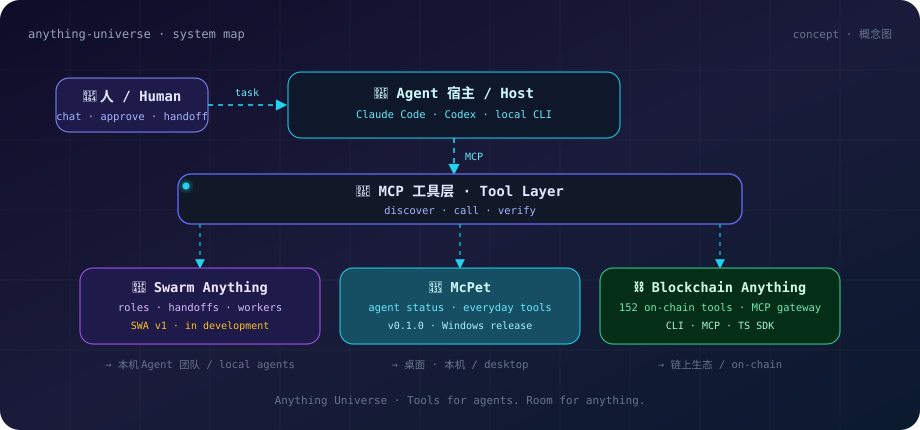
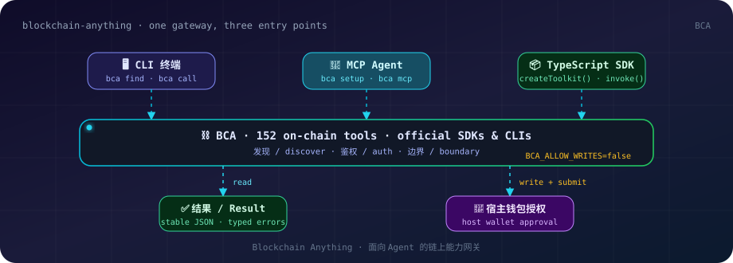
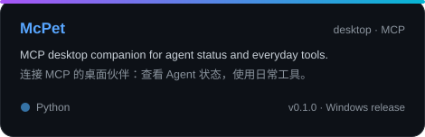
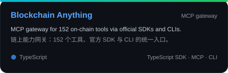
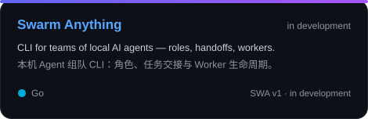
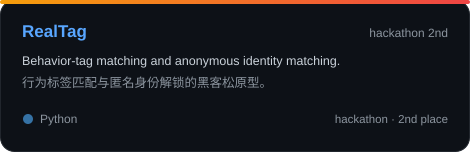
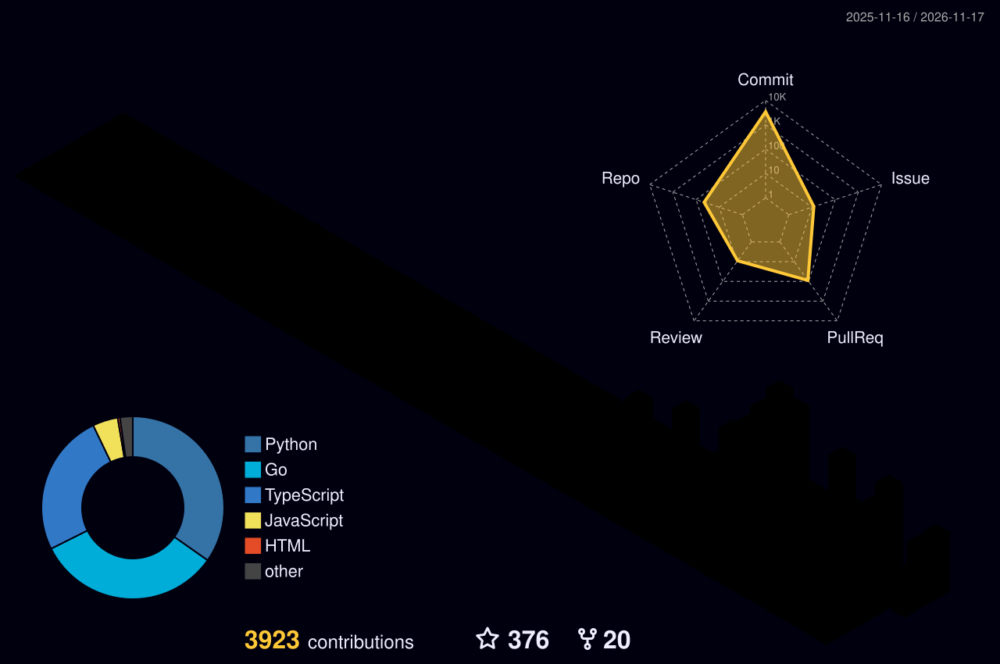

<!-- Header -->
<div align="center">
  
</div>

<div align="center">
  <a href="https://davidwang.space/"></a>
</div>

<div align="center">
  <a href="https://davidwang.space/"></a>
  <a href="https://github.com/songconmaisaix31-design/mcpet"></a>
  <a href="https://github.com/songconmaisaix31-design"></a>
  
</div>

<br/>

## 🧑🏻‍💻 About Me · 关于我

```ts
const david: AgentEngineer = {
  name: "David Wang",
  role: "AI Agent 系统 · 开发者工具 · 开源",
  universe: "Anything Universe · 为 Agent 造工具，为探索留空间",
  focus: ["Agent 协作", "MCP 工具接入", "上下文与记忆", "可验证交付"],
  building: [
    "Swarm Anything (SWA)：本机异构 CLI Agent 的组队、任务交接与 Worker 生命周期（开发中）",
    "McPet：MCP 桌面伙伴 — 查看 Agent 状态、本机用量与日常工具",
    "Blockchain Anything (BCA)：152 个链上工具的 MCP / CLI / SDK 统一入口",
  ],
  stack: ["Go", "TypeScript", "Python", "React", "SQLite", "MCP"],
  principle: "Reuse mature tools. Keep interfaces explicit. Build around real workflows.",
};
```

I build tools that help people work with agents, and agents work together. My current focus is **Swarm Anything** — a CLI for coordinating local coding agents.

我构建人与 Agent 协作、Agent 与 Agent 协作的工具。当前重点是 **Swarm Anything**：让不同本机 CLI Agent 围绕任务组队、执行与交接。个人网站与项目档案在 [davidwang.space](https://davidwang.space/)——保持好奇，继续动手。

- 🐝 &nbsp;**Agent coordination / Agent 协作** — roles, task handoffs, and worker lifecycles；角色、任务交接与 Worker 生命周期
- 🔌 &nbsp;**Tool integration / 工具接入** — MCP servers, CLI adapters, and official SDKs；MCP 服务、CLI 适配与官方 SDK
- 🧠 &nbsp;**Context & memory / 上下文与记忆** — reusable experience and project-scoped context；可复用经验与按项目组织的上下文
- 🧪 &nbsp;**Verifiable delivery / 可验证交付** — status docs, fixtures, and acceptance evidence before any claim；先有状态文档、Fixture 与验收证据，再谈结果

<br/>

## 🌌 Anything Universe · 项目宇宙

*Tools for agents. Room for anything. / 为 Agent 造工具，为探索留空间。*

<table>
<tr>
<td width="50%" valign="top">

### 🐳 [McPet](https://github.com/songconmaisaix31-design/mcpet)
An MCP-connected desktop companion for agent status and everyday tools.
连接 MCP 的桌面伙伴：查看 Agent 状态，使用日常工具。

[Windows release · 发行版](https://github.com/songconmaisaix31-design/mcpet/releases/tag/v0.1.0)

</td>
<td width="50%" valign="top">

### 🐝 [Swarm Anything](https://github.com/songconmaisaix31-design/swarm-anything)
A CLI for teams of local AI agents; in development.
本机异构 Agent 的协作与执行入口，持续开发中。

[Development status · 开发进度](https://github.com/songconmaisaix31-design/swarm-anything/blob/main/STATUS.md)

</td>
</tr>
<tr>
<td width="50%" valign="top">

### ⛓️ [Blockchain Anything](https://github.com/songconmaisaix31-design/blockchain-anything)
Blockchain tools through official SDKs, CLIs, and MCP.
聚合成熟区块链工具，支持发现、连接与调用。

[Online demo · 在线 Demo](https://songconmaisaix31-design.github.io/blockchain-anything/demo/) · [Docs · 文档](https://songconmaisaix31-design.github.io/blockchain-anything/)

</td>
<td width="50%" valign="top">

### 🧪 Beyond the Universe · 其他实验
PayCrew · RealTag · OpenDashboard — prototypes and research.
PayCrew · RealTag · OpenDashboard：更多原型与研究项目。

[PayCrew](https://github.com/songconmaisaix31-design/PayCrew) · [RealTag](https://github.com/songconmaisaix31-design/tongpin-real-tags) · [OpenDashboard](https://github.com/songconmaisaix31-design/OpenDashboard)

</td>
</tr>
</table>

<br/>

## 🏗️ How It Fits · 架构

*人 → 宿主 Agent → MCP 工具层 → Anything Universe 三件工具。Human → host agent → MCP → tools.*

<div align="center">
  
</div>

<br/>

### 🧭 Swarm Anything — 概念图 · concept map

<div align="center">
  
</div>

<sub>概念图 · conceptual — Swarm Anything 仍在开发中，图示为设计意图，不代表已发布功能。Concept map, not shipped behavior.</sub>

<br/>

### ⛓️ Blockchain Anything — 一个网关，三个入口 / one gateway, three entry points

<div align="center">
  
</div>

<sub>CLI / MCP / TypeScript SDK 共用同一套工具定义与写入闸门。Three entry points, one tool definition and write gate.</sub>

<br/>
## 🛠️ AI Tech Stack · 技术栈

<table>
<tr>
<td align="center" width="170"><b>🧠 Agent &amp; MCP</b></td>
<td>


</td>
</tr>
<tr>
<td align="center" width="170"><b>🐝 Agent 协作</b></td>
<td>


</td>
</tr>
<tr>
<td align="center" width="170"><b>💻 Languages</b></td>
<td>


</td>
</tr>
<tr>
<td align="center" width="170"><b>🎨 Frontend &amp; Full-stack</b></td>
<td>


</td>
</tr>
<tr>
<td align="center" width="170"><b>🗄️ Data &amp; Contracts</b></td>
<td>


</td>
</tr>
<tr>
<td align="center" width="170"><b>🧪 AI &amp; Research</b></td>
<td>


</td>
</tr>
<tr>
<td align="center" width="170"><b>⛓️ Blockchain (BCA coverage)</b></td>
<td>


</td>
</tr>
<tr>
<td align="center" width="170"><b>⚙️ Runtime &amp; Infra</b></td>
<td>


</td>
</tr>
</table>

<br/>

## 💻 Languages & Toolchain · 语言与工具链

<div align="center">
  
  <br/>
  
  <br/><br/>
  
  
  
  
  
  
</div>

<br/>

## 🧭 Engineering Focus · 工程方向

<table>
<tr>
<td width="50%" valign="top">

### 🐝 Agent coordination
Roles, task handoffs, and worker lifecycles — 角色、任务交接与 Worker 生命周期。

</td>
<td width="50%" valign="top">

### 🔌 Tool integration
MCP servers, CLI adapters, and official SDKs — MCP 服务、CLI 适配与官方 SDK。

</td>
</tr>
<tr>
<td width="50%" valign="top">

### 🧠 Context & memory
Reusable experience and project-scoped context — 可复用经验与按项目组织的上下文。

</td>
<td width="50%" valign="top">

### 🧪 Verifiable delivery
Status docs, fixtures, and acceptance evidence — 状态文档、Fixture 与验收证据。

</td>
</tr>
</table>

<br/>

## 📌 Featured Projects · 代表项目

<table>
<tr>
<td width="50%"><a href="https://github.com/songconmaisaix31-design/mcpet"></a></td>
<td width="50%"><a href="https://github.com/songconmaisaix31-design/blockchain-anything"></a></td>
</tr>
<tr>
<td width="50%"><a href="https://github.com/songconmaisaix31-design/swarm-anything"></a></td>
<td width="50%"><a href="https://github.com/songconmaisaix31-design/tongpin-real-tags"></a></td>
</tr>
</table>

<br/>

## 📊 GitHub Stats · 数据

<div align="center">
  
  
  <br/>
  
  <br/>
  
</div>

<br/>

## 🧊 3D Contributions · 3D 贡献图

<div align="center">
  <picture>
    <source media="(prefers-color-scheme: dark)" srcset="https://raw.githubusercontent.com/songconmaisaix31-design/songconmaisaix31-design/main/profile-3d-contrib/profile-night-rainbow.svg" />
    <source media="(prefers-color-scheme: light)" srcset="https://raw.githubusercontent.com/songconmaisaix31-design/songconmaisaix31-design/main/profile-3d-contrib/profile-season-animate.svg" />
    
  </picture>
</div>

<br/>

## 🐍 Contribution Snake · 贪吃蛇

<div align="center">
  <picture>
    <source media="(prefers-color-scheme: dark)" srcset="https://raw.githubusercontent.com/songconmaisaix31-design/songconmaisaix31-design/output/github-contribution-grid-snake-dark.svg" />
    <source media="(prefers-color-scheme: light)" srcset="https://raw.githubusercontent.com/songconmaisaix31-design/songconmaisaix31-design/output/github-contribution-grid-snake.svg" />
    
  </picture>
</div>

<br/>

## 🏆 Selected Work · 代表成果

- **First Prize · iFLYTEK AI Developer Conference 2026** — multi-system collaboration for investment research / 投研分析领域多系统协同。[Project snapshot · 项目记录](https://davidwang.space/projects/research.md)
- **Hackathon 2nd place · 纯爱战神黑客松全场第二** — RealTag: behavior-tag matching and progressive identity unlock / 行为标签匹配与渐进式身份解锁原型。[Repo · 仓库](https://github.com/songconmaisaix31-design/tongpin-real-tags)
- **nano-vLLM** — opened an idempotent engine-shutdown fix (#283, open — not merged) / 提交引擎重复退出与清理修复（PR #283，open，未合并）。[PR #283 · 改动与讨论](https://github.com/GeeeekExplorer/nano-vllm/pull/283)
- **McPet** — v0.1.0 Windows release / v0.1.0 Windows 发行版。[Release](https://github.com/songconmaisaix31-design/mcpet/releases/tag/v0.1.0)

Explore the code, try a release, or open an issue with a concrete use case. I welcome collaboration on agent integrations and developer tooling.

欢迎体验项目、提交具体使用场景，一起完善 Agent 接入与开发者工具。

<br/>

## 🧭 Principles · 原则

> **Reuse mature tools. Keep interfaces explicit. Build around real workflows.**
>
> 复用成熟工具，明确接口，围绕真实工作流程开发。

<br/>

<div align="center">
  <a href="https://davidwang.space/">🌐 davidwang.space</a> &nbsp;·&nbsp;
  <a href="https://github.com/songconmaisaix31-design">GitHub</a> &nbsp;·&nbsp;
  <a href="https://songconmaisaix31-design.github.io/blockchain-anything/">BCA Docs</a>
  &nbsp;·&nbsp; <i>"Tools for agents. Room for anything."</i>
</div>


